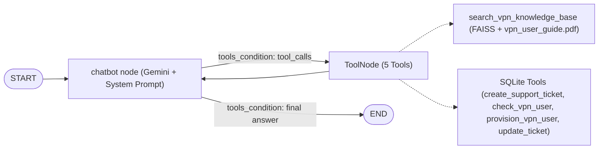

# Autonomous IT Tech Support Agent with LangGraph & Multi-Tool RAG

In this project, I built an autonomous IT tech support agent using **LangGraph**, **LangChain**, and **Google Gemini**. It troubleshoots corporate VPN issues using dense vector retrieval (RAG) over internal PDF documentation and executes deterministic actions against a local SQLite database through a stateful LangGraph workflow.

I configured this project to run on the **Google Gemini** free tier using `ChatGoogleGenerativeAI` (configurable via `GEMINI_MODEL`, defaulting to `gemini-1.5-flash`) and `models/gemini-embedding-001`.

---

## Key Capabilities I Implemented
- **Multi-Tool Agentic Reasoning:** The agent decides whether to answer questions from the knowledge base or invoke operational tools to create tickets, check VPN account permissions, reactivate inactive accounts, provision new users, or update ticket statuses.
- **Dense Vector Search (RAG):** Uses FAISS and Google Gemini embeddings (`models/gemini-embedding-001`) to index and retrieve answers from `vpn_user_guide.pdf`.
- **Deterministic Action Layer:** Executes structured SQLite CRUD operations (`support_demo.db`) for support tickets and VPN user access records.
- **LangGraph State Machine:** Cyclical graph using `MessagesState`, a `chatbot` reasoning node, dynamic `ToolNode`, and `tools_condition` routing.
- **Split-Screen Streamlit UI:** Interactive chat paired with live SQLite database tables (`tickets`, `vpn_user_access`) and a real-time LangGraph tool execution trace (`app.py`).
- **Free-Tier Ready:** Powered by Google AI Studio (`GOOGLE_API_KEY` / `GEMINI_API_KEY`) with no paid API subscription required.

---

## Architecture



---

## Demo Scenarios to Try in the UI

| Scenario | Sample Prompt | Expected Agent & DB Behavior |
| :--- | :--- | :--- |
| **1. RAG Knowledge Lookup** | *"How do I install and connect to the Acme Corp VPN?"* | Queries `search_vpn_knowledge_base` over `vpn_user_guide.pdf` without modifying SQLite. |
| **2. Inactive Account Reactivation** | *"My VPN isn't working. My name is Bob Jones and I keep getting a connection denied error."* | Opens a ticket (`T-xxxxxx`), asks to check access, then calls `check_vpn_user` and flips `Bob Jones` from `inactive` to `active`. |
| **3. New User Provisioning** | *"Hi, I'm Sarah Connor and I need VPN access set up for my laptop."* | Logs a ticket, detects `Sarah Connor` is missing via `check_vpn_user`, asks consent, then calls `provision_vpn_user` to insert an `active` row. |

---

## Project Structure
```
01-langgraph-autonomous-tech-support-agent/
│
├── app.py                                          # Split-screen Streamlit UI (chat + live SQLite & tool trace)
├── .streamlit/config.toml                          # Streamlit browser config (disables usage stats prompt)
├── Autonomous_Tech_Support_Agent_LangGraph.ipynb   # Master engineering notebook
├── tech_support_agent.py                           # LangGraph agent core, tools & standalone CLI
├── build_knowledge_base.py                         # FAISS vector store build script
├── tests/test_agent.py                             # Unit tests for SQLite tools & LangGraph trace helpers
├── vpn_user_guide.pdf                              # Corporate VPN documentation corpus
├── requirements.txt                                # Dependencies (langgraph, langchain-google-genai, faiss-cpu, streamlit)
├── .env.example                                    # Environment variable template
├── .gitignore                                      # Ignored local secrets, cache, and runtime artifacts
└── README.md                                       # Project documentation
```

---

## Getting Started

### 1. Environment Setup
Install the dependencies:
```bash
pip install -r requirements.txt
```

### 2. Configure Free Google Gemini API Key
1. Get a free API key from [Google AI Studio](https://aistudio.google.com).
2. Create a `.env` file in this directory (or copy `.env.example`):
```bash
GOOGLE_API_KEY="your-gemini-api-key"
```

### 3. Build Knowledge Base & Launch
- **Run the Interactive Streamlit UI (Recommended for demos):**
  ```bash
  python -m streamlit run app.py
  ```
- **Run the Standalone CLI Agent:**
  ```bash
  python tech_support_agent.py
  ```
- **Or Run the Master Notebook:**
  ```bash
  jupyter lab Autonomous_Tech_Support_Agent_LangGraph.ipynb
  ```

### 4. Run Unit Tests
```bash
python -m unittest discover -s tests -v
```
